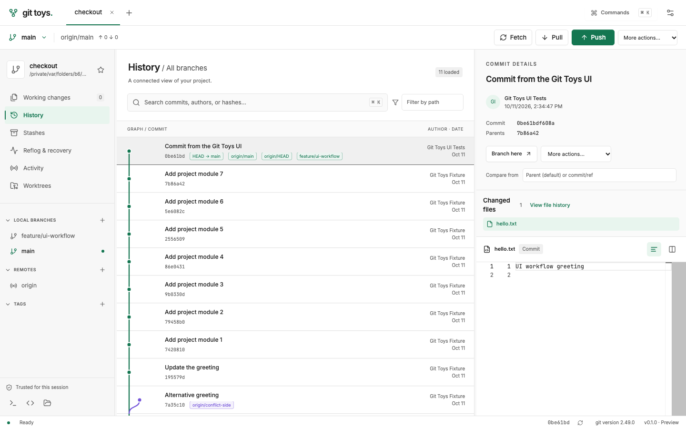
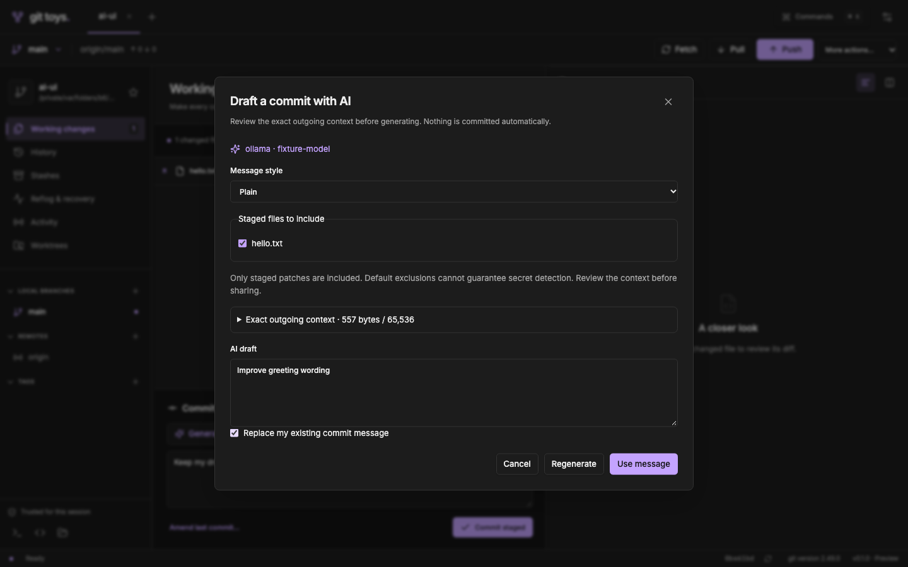
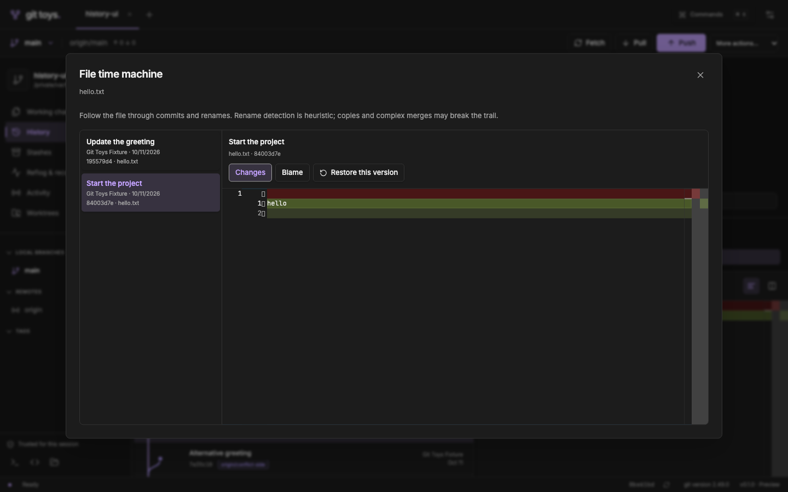
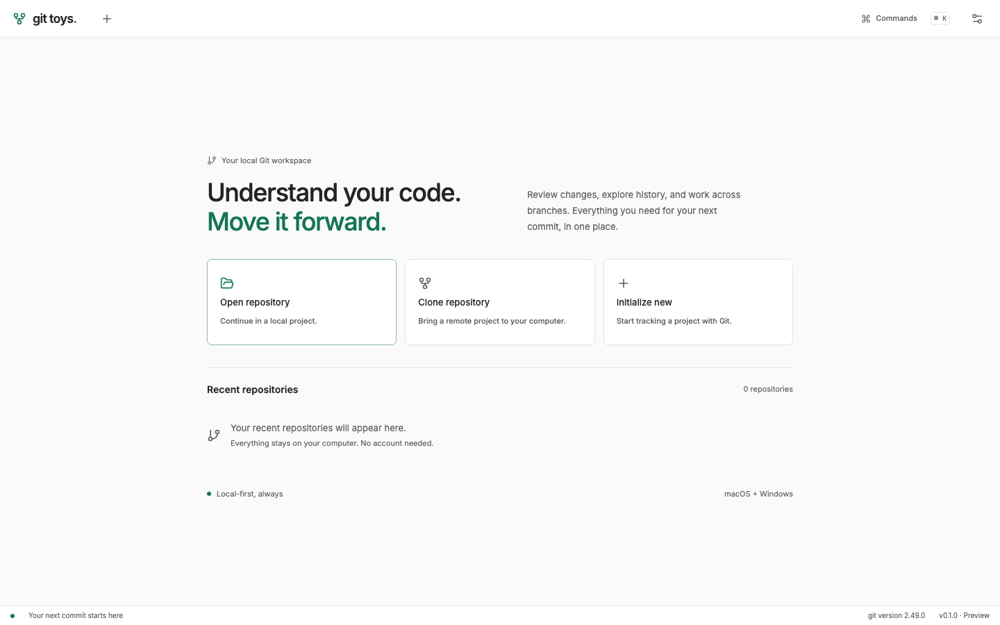
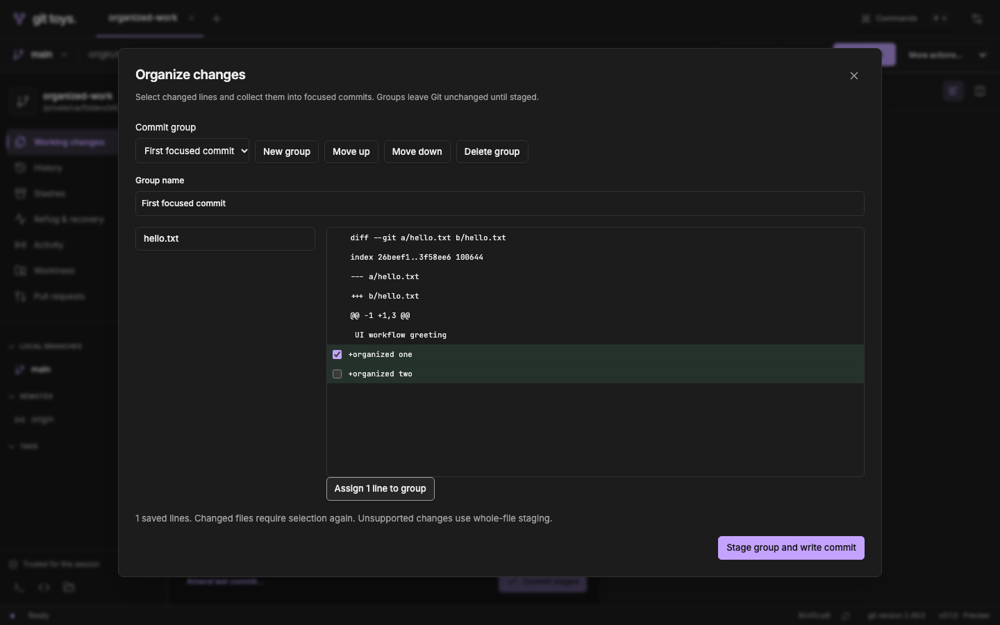
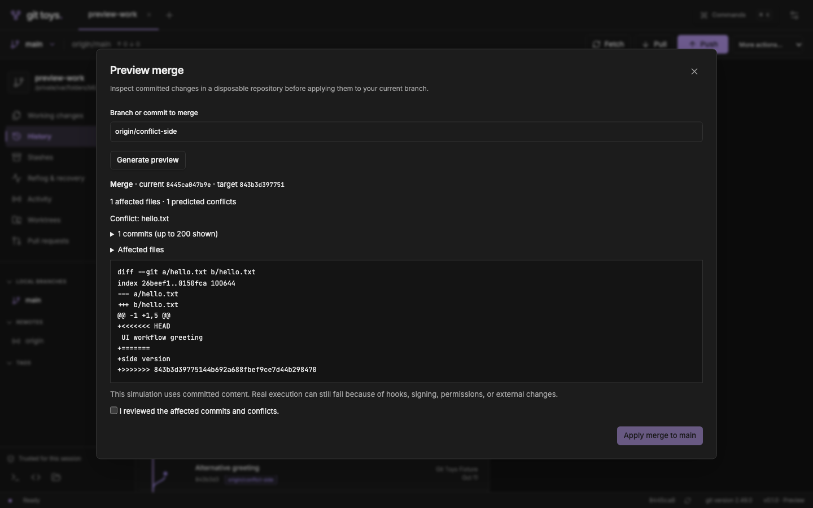
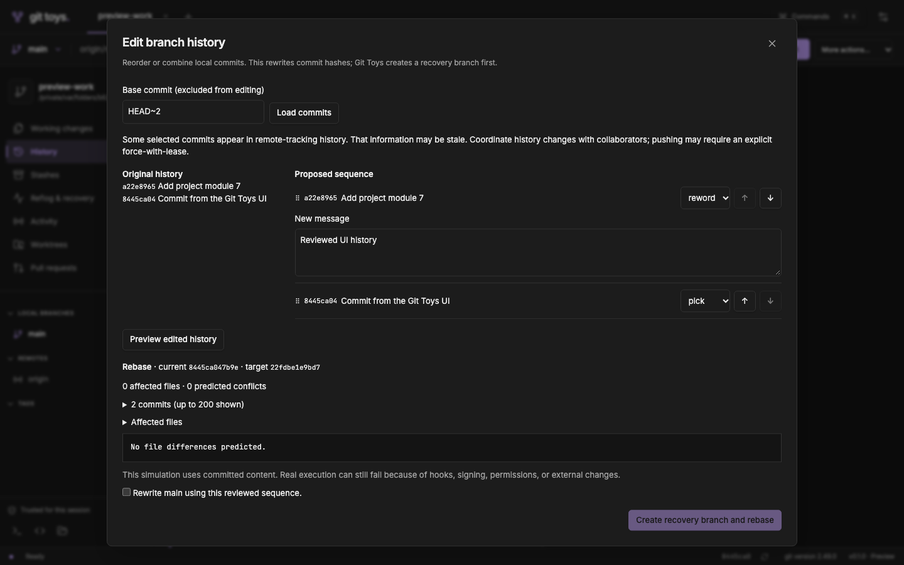
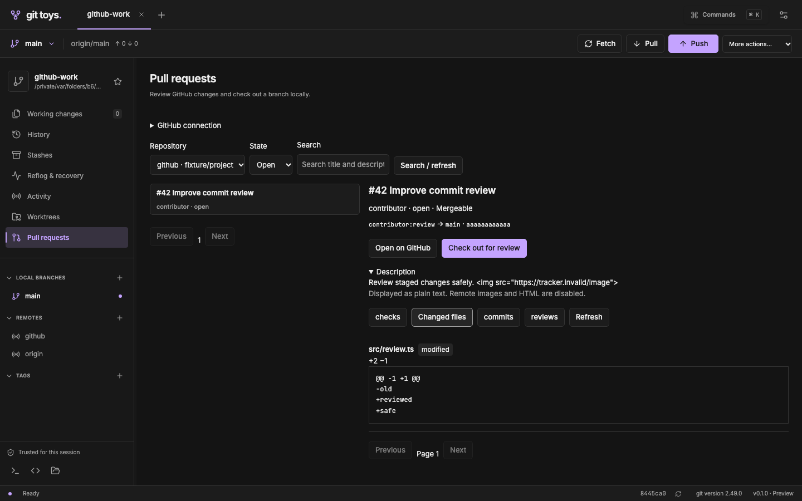
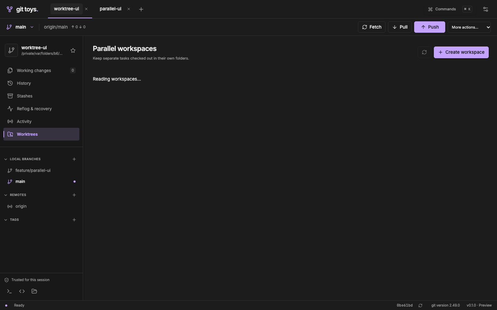

<p align="center">
  
</p>

<h1 align="center">Git Toys</h1>

<p align="center">
  <strong>Understand your code. Move it forward.</strong><br />
  A free, local-first desktop Git client for macOS and Windows.
</p>

<p align="center">
  <code>macOS + Windows</code> · <code>Local-first</code> · <code>No Git Toys account</code> · <code>0.1.0 preview</code>
</p>



<table>
  <tr>
    <td width="50%"></td>
    <td width="50%"></td>
  </tr>
  <tr>
    <td align="center"><strong>Review first. Generate a draft.</strong></td>
    <td align="center"><strong>Go back in time, one file at a time.</strong></td>
  </tr>
</table>

<sub>Screenshots show the current shared interface using disposable Git repositories in browser acceptance tests. They are not native Windows validation; the AI response and GitHub PR data shown are test fixtures.</sub>

<p align="center">
  <a href="#get-started">Get started</a> ·
  <a href="#your-first-commit">Your first commit</a> ·
  <a href="#ai-commit-messages">AI messages</a> ·
  <a href="#parallel-workspaces">Workspaces</a> ·
  <a href="#build-from-source">Build from source</a>
</p>

## What you can do

| Work                    | Git Toys makes it visible                                                                |
| ----------------------- | ---------------------------------------------------------------------------------------- |
| Understand a repository | Branch graph, searchable history, commit details and comparisons                         |
| Organize mixed edits    | Select changed lines, save named commit groups, stage and commit each group              |
| Preview history changes | Isolated merge/rebase previews and visual interactive rebase with recovery branches      |
| Review contributions    | Optional GitHub.com PR browsing, checks, diffs and verified review-branch checkout       |
| Make a commit           | Staged/unstaged files, inline or side-by-side diffs, file and hunk staging, commit/amend |
| Work with others        | Fetch, explicit pull strategy, push, upstream tracking, branches, tags and remotes       |
| Handle complex changes  | Merge, rebase, cherry-pick, revert, stash, reset and conflict resolution                 |
| Keep tasks separate     | Create, open and safely remove Git worktrees                                             |
| Recover context         | File history, blame, historical-file restoration and reflog recovery                     |
| Make it yours           | Light/dark/system appearance, 25 palettes, resizable panels and keyboard commands        |

Git Toys is free and closed source. Everyday Git work needs no Git Toys account, telemetry service or application backend. Remote repositories still use your hosting credentials, and optional cloud AI uses your own API account.

## Get started

**This is an unsigned 0.1.0 preview, not a signed public release.** There is no configured public download feed or automatic updater yet. Preview installers come from local builds or CI artifacts when available. See [validation](docs/VALIDATION.md) for what has been tested.

### Choose your system

|                      | macOS                                                      | Windows                                                     |
| -------------------- | ---------------------------------------------------------- | ----------------------------------------------------------- |
| Target system        | macOS 13.3 or newer                                        | Windows 10 22H2 or newer, with WebView2                     |
| Architecture         | Apple Silicon (`aarch64`) or Intel (`x86_64`)              | x64 (`x86_64`)                                              |
| Installer            | `.dmg` containing `Git Toys.app`                           | Setup `.exe` (NSIS) or `.msi` (WiX), depending on the build |
| Git                  | Git 2.43 or newer, installed separately                    | Git for Windows 2.43 or newer, available on `PATH`          |
| Cloud AI key storage | macOS Keychain                                             | Windows Credential Manager                                  |
| Local validation     | Apple Silicon preview built; selected native checks passed | Native qualification remains pending                        |

Configured minimum OS versions, Intel macOS and native Windows workflows still need release testing. CI defines builds for all three architectures; this does not mean those installers have been published or qualified.

### macOS setup

1. Install or update Git using the [official macOS installation options](https://git-scm.com/downloads/mac). In Terminal, run `git --version` and check that it is **2.43 or newer**.
2. Obtain a preview built for your Mac: **Apple Silicon** for M-series Macs, **Intel** for Intel Macs. You can check your chip in **Apple menu → About This Mac**.
3. Open the DMG and copy **Git Toys** to **Applications**, then launch it. For a local build, the app is inside the bundle output described below. Current previews are unsigned and not notarized; macOS may block launching them.
4. If Git was installed while Git Toys was running, quit and reopen the app. Check **Settings and Git diagnostics** to confirm Git is detected.

### Windows setup

1. Install [Git for Windows](https://git-scm.com/downloads/win) and ensure Git is available to other applications through `PATH`.
2. Open a new PowerShell window and run `git --version`. It must report **2.43 or newer**.
3. Install the x64 preview using its setup `.exe` or `.msi`. Windows also needs the [Microsoft Edge WebView2 Runtime](https://developer.microsoft.com/en-us/microsoft-edge/webview2/). Development setup is covered in [Tauri's Windows prerequisites](https://v2.tauri.app/start/prerequisites/#windows).
4. Launch Git Toys. If Git was just installed, restart the app so it sees the updated environment. Current installers are unsigned previews and may trigger Windows security prompts.

**Using an installer does not require Node.js, pnpm or Rust.** Those are needed only to run or build the source.

### Open your first project

From the welcome screen, choose:

- **Open repository** — select the folder of an existing local Git repository.
- **Clone repository** — enter an HTTPS or SSH Git URL and choose a new or empty destination folder.
- **Initialize new** — start Git tracking in a new or empty folder.

<details>
<summary>See the welcome screen</summary>



</details>

Existing repositories open read-only. Select **Trust repository to make changes** when you trust the project and its Git tooling. Clone and initialization also ask you to acknowledge trust. Trusted Git operations can run configured hooks, filters, credential helpers and signing programs. Trust applies to the current app session.

Git Toys uses your existing Git identity and authentication configuration. If you have never configured a commit identity, you can explicitly set one in Terminal or PowerShell:

```sh
git config --global user.name "Your Name"
git config --global user.email "you@example.com"
```

These commands change your default identity for all repositories. To configure only one project, run them inside that project without `--global`.

## Your first commit

1. **Create a branch.** Use the local-branches **+** button or **More actions → Create branch**. Switch to it through **More actions → Switch branch** or double-click the local branch.
2. **Make your changes** in your editor, then select **Working changes** in Git Toys.
3. **Review the diff.** Select a file; switch between inline and side-by-side views as needed.
4. **Stage deliberately.** Use the **+** beside a file, **Stage all**, or the diff's hunk controls. Unstage anything you do not want in this commit.
5. **Write a message** or generate an AI draft. Choose **Commit staged**. Amend is available when you intentionally want to change the latest commit.
6. **Synchronize.** Fetch to update remote information. Pull using an explicit strategy, then push. Publish a new branch to set its upstream when needed.

Push shows loading feedback. Successes, warnings and errors appear as notifications; expand Git output when an operation fails. Ordinary push is the default. Force-with-lease is a separate advanced action.

### History, conflicts and recovery

- **History:** search by message, author or hash; use branch/path filters; select a commit to inspect its files or compare against another ref.
- **Conflicts:** open the conflicted file in Working changes, review base/ours/theirs, edit the result, save and mark resolved. Continue or abort from the active-operation controls. During rebase, ours/theirs have a different meaning; read the dialog explanation.
- **Reflog & recovery:** restore a selected commit onto a new branch. Reflog can help recover reference movements; it is not a backup of discarded uncommitted files.
- **More actions:** merge, rebase, cherry-pick, revert, stash, reset and manage refs/remotes. Read the affected branch and history-change details before confirming.

## AI commit messages

AI starts **disabled**. Open **Settings → AI commit messages**, enable drafts, choose a provider and enter a model ID.

| Provider  | Setup                                                                                             | Where generation runs                             |
| --------- | ------------------------------------------------------------------------------------------------- | ------------------------------------------------- |
| Ollama    | Start Ollama and select an already-installed local model; default URL is `http://127.0.0.1:11434` | Through your local Ollama endpoint                |
| OpenAI    | Enter an available API model ID and save your API key                                             | OpenAI API; your API account may incur charges    |
| Anthropic | Enter an available API model ID and save your API key                                             | Anthropic API; your API account may incur charges |

Stage changes, choose **Generate with AI**, and review the selected files and **exact outgoing context**. Exclude files as needed, choose **Plain** or **Conventional Commit**, then generate. Edit the draft and select **Use message** when ready. Replacing an existing message requires explicit acceptance; generation never commits automatically.

- Only staged changes are included. Binary/unsupported content and common credential filenames are excluded by default; this cannot guarantee secret detection.
- Context is limited to **64 KiB**. Reduce the file selection if it is too large; it is never silently truncated.
- Cancel a running request at any time; requests time out after 120 seconds. Index changes require a fresh review and regeneration.
- Cloud keys stay in the OS credential store. Keys, patches and generated drafts stay out of preferences and the activity journal.
- Git Toys does not install models or configure Ollama. For local-only Ollama use, follow the [Ollama guidance for disabling cloud features](https://docs.ollama.com/faq) and restart Ollama. A loopback endpoint alone does not guarantee local model execution.

**ChatGPT/Codex subscription sign-in is not implemented.** The current OpenAI option uses an API key; it does not connect to the ChatGPT application.

## Organize mixed changes

Choose **Organize changes** in Working changes. Create a named group, select a file, and tick its added/deleted lines. Use **Assign lines to group** to save the selection; assigning the same lines to another group moves them. Rename groups or reorder them with Move up/down.

**Stage group and write commit** requires an empty index. It stages the selected content and returns to the composer, preserving an existing message. Review the staged diff, optionally generate an AI message, and commit. Remaining edits stay in your working tree. Groups contain names and selection fingerprints rather than patch backups; external edits or commits can invalidate selections, which must be reviewed again.

Line grouping initially supports modified, tracked UTF-8 text within the editor limit. Other changes retain whole-file staging. Keyboard users can Tab to line checkboxes and press Space.



## Preview merges and edit history

Use **More actions → Preview merge / Preview rebase** to inspect committed changes in a disposable repository. Git Toys displays pinned hashes, commits, affected files and predicted conflicts. Rebase preview stops at the first conflict and marks later commits untested. Apply requires a clean repository and revalidates the reviewed state. Hooks, signing, filesystem permissions and later external changes can still make real execution fail.

Previews disable hooks, external tooling and network transports. Repositories with attributes, custom local filters/merge drivers, symlinks or submodules are explicitly unsupported for simulation; rebase previews support up to 200 replayed commits. Cancellation or the two-minute execution limit removes the disposable repository. After restart, abandoned preview directories older than ten minutes are cleaned up, avoiding another active preview instance.



Choose **Edit branch history** in History or More actions, enter a base such as `HEAD~3`, and load its following commits. Reorder with dragging or Move up/down; choose Pick, Reword, Squash, Fixup or Drop. Edit the final message for Reword/Squash and preview the proposed sequence before confirming.

The first version supports 1–200 commits on a clean, attached branch and rejects ranges containing merge commits. A visible `git-toys/recovery/...` branch preserves the original tip before rewriting. Conflicts use the existing resolver and Continue/Abort controls, including after reopening the app. Published-history warnings use local remote-tracking information, which may be stale. Git Toys never pushes rewritten history automatically.



## GitHub pull requests

Add a GitHub.com remote and open **Pull requests** to browse requests, descriptions, checks, changed files, commits and reviews. **Check out for review** confirms the exact head and creates a review branch without overwriting existing local review commits. Descriptions render as plain text with remote images disabled.

Public requests can be browsed anonymously. Optional browser sign-in stores authorization in the OS credential vault; private access requires an explicit broader permission choice. The publisher must first register a GitHub OAuth app and configure its public client ID—**the local preview has no configured OAuth registration yet**. See the [GitHub setup guide](docs/GITHUB.md). Git credentials remain separate. Creating, commenting, approving and merging PRs stay on GitHub for now.



## Parallel workspaces

Open **Worktrees → Create workspace**. Choose a new, nonexistent destination inside an existing parent folder, then select an existing branch or create a new branch from a ref. Git creates a separate checkout so your current task stays where it is.

**Open workspace** reuses an existing repository tab when possible. **Remove workspace** previews the exact folder and preserves its branch. Main, dirty (including ignored files), locked, missing, unreadable and actively operating worktrees cannot be removed through this UI. Move, repair, prune and lock management remain deferred.



## File time machine

Choose **View file history** from a working-file or commit-file action. Select revisions in the timeline, use **Blame** to see each line's author/date/commit, or open commit details from an annotation.

**Restore this version** previews the current file against the selected version. Confirm to create an **unstaged** change at the current path, then review and commit normally. Restoration refuses to overwrite staged or unstaged changes. For a deleted revision, select an earlier version where the file exists.

Rename following is heuristic. The viewer initially supports tracked UTF-8 text up to **2 MB**, excluding binary files, symlinks and submodules.

## Shortcuts and desktop tools

| Action                  | macOS                                            | Windows                                       |
| ----------------------- | ------------------------------------------------ | --------------------------------------------- |
| Command palette         | `⌘ K`                                            | `Ctrl K`                                      |
| Open repository         | `⌘ O`                                            | `Ctrl O`                                      |
| Refresh repository      | `⌘ R`                                            | `Ctrl R`                                      |
| Resize a panel          | Drag its divider, or focus it and use arrow keys | Same                                          |
| Navigate file revisions | Arrow keys, `Home`, `End`                        | Same                                          |
| Open file manager       | Finder                                           | File Explorer                                 |
| Open terminal here      | Terminal.app                                     | Windows Terminal (`wt.exe` must be installed) |
| Open in editor          | VS Code (`code` must be available on `PATH`)     | Same                                          |

External tools are in the sidebar footer. Terminal/editor launch requires repository trust. In Settings, choose **Light**, **Dark** or **System** and one of 25 palettes; selections save locally. Palette cards support arrow-key navigation.

## Troubleshooting

| Symptom                                      | What to check                                                                                                                       |
| -------------------------------------------- | ----------------------------------------------------------------------------------------------------------------------------------- |
| Git is missing or too old                    | Run `git --version`, install 2.43+, then restart Git Toys. Check Settings diagnostics and the app's `PATH`.                         |
| Stage, commit or branch actions are disabled | Trust the repository; wait for active operations; stage changes before committing.                                                  |
| Push is rejected                             | Fetch first, inspect the remote changes, then merge/rebase with the intended strategy. Avoid using force as a routine fix.          |
| Authentication, hook or signing fails        | Expand the notification's Git output. Verify your existing Git helper, SSH agent, hook or signing configuration outside the app.    |
| A diff is unsupported                        | Check for binary/non-UTF-8 content, submodules, symlinks or the 2 MB editor limit.                                                  |
| A worktree will not remove                   | Inspect dirty/ignored files, lock state and active operations. Its branch will remain after a safe removal.                         |
| AI cannot generate                           | Confirm the provider/model, staged selection, endpoint/API key, quota and 64 KiB limit. Review context again after an index change. |
| External editor/terminal will not open       | Install VS Code's `code` command or Windows Terminal as appropriate; restart Git Toys after changing `PATH`.                        |
| Updates are unavailable                      | No release feed is configured yet. Replace preview builds manually, quitting the old app before reopening.                          |

## Build from source

For developers with access to this closed-source project. No repository/download URL is assumed here.

Install **Node.js 24**, **pnpm 10** (project version: 10.34.5), **Rust 1.91.1+** and **Git 2.43+**. Then install the native [Tauri prerequisites](https://v2.tauri.app/start/prerequisites/):

- **macOS:** Xcode Command Line Tools (`xcode-select --install` for desktop development).
- **Windows:** Visual Studio Build Tools with **Desktop development with C++**, the Windows SDK and WebView2; use Rust's MSVC toolchain. Restart PowerShell after installation.

From the project folder, the following commands work in macOS Terminal and Windows PowerShell:

```sh
pnpm install --frozen-lockfile
pnpm tauri dev
```

`pnpm dev` alone starts a browser preview. It has no production access to local Git; use `pnpm tauri dev` for the desktop app.

Build on the target operating system:

```sh
pnpm tauri build
node scripts/checksums.mjs
```

| Build                  | Default output folder              |
| ---------------------- | ---------------------------------- |
| macOS app              | `target/release/bundle/macos/`     |
| macOS DMG              | `target/release/bundle/dmg/`       |
| Windows NSIS installer | `target/release/bundle/nsis/`      |
| Windows MSI installer  | `target/release/bundle/msi/`       |
| Installer checksums    | `target/release/bundle/SHA256SUMS` |

Explicit `--target` builds add the target triple between `target/` and `release/`. For a local debug Mac preview, run `pnpm tauri build --debug --bundles app,dmg` and `node scripts/checksums.mjs target/debug/bundle`; outputs use `target/debug/bundle/`.

<details>
<summary><strong>Developer checks and architecture</strong></summary>

Vue 3 / TypeScript / Pinia form the UI; Tauri 2 provides the desktop shell; a separate Rust engine executes installed Git through argument arrays.

```sh
pnpm check
cargo fmt --all --check
cargo clippy --workspace --all-targets --locked -- -D warnings
cargo test --workspace --locked
pnpm check:duplicates
pnpm exec playwright install chromium
pnpm test:e2e
```

Rust tests export TypeScript contracts into `src/lib/generated`; do not edit generated files. Complete Rust checks before browser workflows to avoid binding updates triggering a Vite reload. The browser suite uses a test-only transport and disposable real Git repositories; it does not prove native IPC, OS dialogs or live authentication. Documentation screenshots suppress notification overlays during capture only.

jscpd 4.0.5 measures exact clones with a 10-line minimum, excluding generated code and fixtures. The synthetic history benchmark is available through `python3 scripts/benchmark.py` when Python 3 is installed. Native Windows, Intel/minimum-OS, accessibility, signing and live-provider release gates are recorded separately.

</details>

[Design](docs/DESIGN.md) · [Architecture](docs/ARCHITECTURE.md) · [Validation](docs/VALIDATION.md) · [Release process](docs/RELEASING.md) · [Roadmap](docs/ROADMAP.md)
